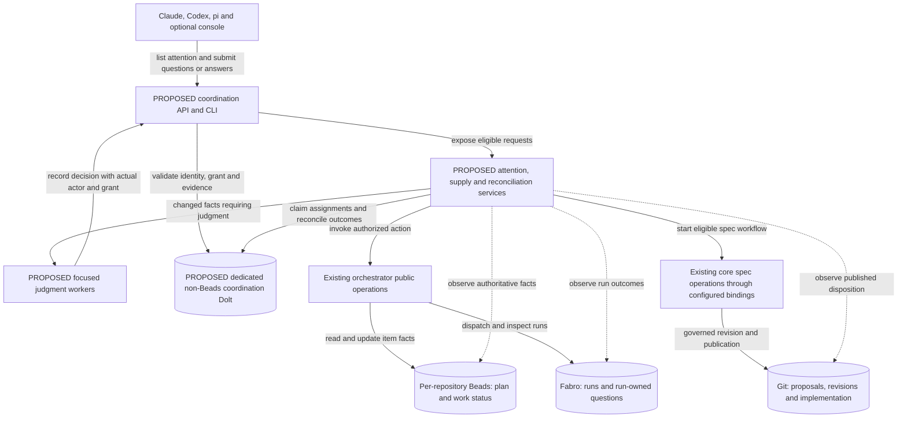
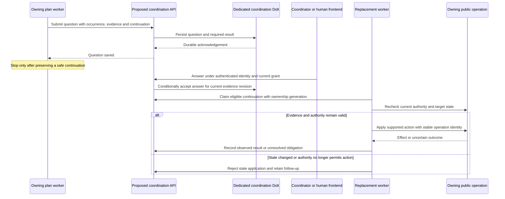
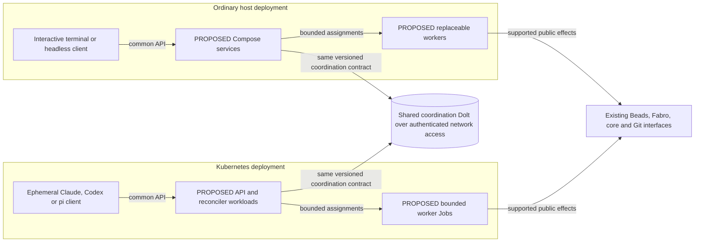

# 013 — Portable coordination: architecture and delivery proposal

[Back to index](https://github.com/thewoolleyman/livespec-orchestrator-beads-fabro/blob/master/plan/dispatch-control-plane/research/README.md)

Design elaborated 13 November 2026 · **Dispatch control plane and durable dispatcher state** (`bd-ib-k6dqwc`).

## Goal and present position

Open one attention view, see what requires a decision, answer it, and leave. The
right work continues even if its original worker has disappeared. Independent
work keeps moving while a question waits. Claude, Codex and pi use the same
coordination contracts, from ordinary hosts or temporary Kubernetes pods.

This consolidated **proposal** replaces reports 009–012. Its architecture is a
target, not a deployed system. The journal-read and audit-growth stopgaps shipped;
the maintainer accepted proportionate confidence in their relief without another
exhaustive benchmark. The separately owned **Spec-side autonomy follow-up**
(`livespec-7ap2fb`) has also passed independent proof and archived. This corrects
report 012's startup-only account. It established released wording and a bounded,
explicitly initiated delegated-revise flow, not an automatic spec-work scheduler.

The original six plan assertions still govern completion. This rewrite neither
changes them nor ratifies proposed phase-two acceptance scenarios. Live status
and rulings remain in the ledger. The appendix preserves the responsibility
inventory, reconciled evidence and source trail. The November 1 legacy-role
cutover below supersedes the older reports' incumbent-coordinator assumption.

## Architecture, APIs and flows at a glance

These complementary views follow livespec's **Tool-agnostic workflow**,
**Revision loop**, **Workflow planes and the Planning Lane**, and **Contract +
reference implementations architecture**: component boundaries, an operation,
then deployment. They are draft extensions, not replacements for core's diagrams.

In flowcharts, cylinders are authoritative stores, boxes are components, solid
arrows are labeled calls or writes, and dotted arrows are observations. Proposed
components are labeled. Sequence arrows show requests and replies in time order.
“Submit answer” and similar labels describe proposed API capabilities, not
commands available in today's installation.

### Component and API boundaries

The orchestrator owns the new coordination operations and action rules. Existing
shared attention types remain in livespec-runtime; supervision integration stays
with overseer, and the console presents public operations. New coordination
schemas stay with their owning producer until actual shared use warrants extraction.
Beads,
Fabro and core retain existing authority. Shared services reference their facts
rather than creating another status authority. A run-owned Fabro question keeps
its run/question identity and existing answering interface.

The thin **spec Drivers** continue to bind core's prose and configured spec-side
CLIs, with no direct dependency on orchestrator internals. A coordination adapter
for Claude, Codex or pi is a separate integration into the common API. Using the
same agent tool does not make it a spec Driver dependency. Plan-operation prose
remains in this orchestrator; shared spec semantics remain in core.

### One durable question, answer and continuation

An acknowledged question is saved work. An accepted answer is a decision. An
applied action is an effect. Completion means observing the original required
result. Each needs its own record. The attention view groups facts by cause, routes them
by required action and time to consequence, and includes evidence and a decision
packet when a ruling is needed. Multiple frontends display the same decision
identity, rather than creating competing prompts. Questions support free text
and follow-up as well as fixed choices.

### The same contracts in two deployment environments

Use the same released service builds and application semantics in both modes.
Database lifecycle, factory execution, telemetry, account policy and GitOps stay
with their existing owners. The picture shows supported connections; image
packaging and infrastructure topology are in **Decisions remaining** below.

## Settled boundaries and operating rules

**Dedicated non-Beads Dolt owns cross-tenant coordination.** Questions, answers,
delivery, assignments, action requests, shared holds, reservations and ownership
belong there when another owning system does not already supply them. A plan's
Beads ledger holds its own work, status, rulings and history. Fabro holds run
facts. Git holds source and revision bytes. The maintainer rejected using plan
comments as the initial fleet queue; stronger comment ordering would not repair
that ownership mistake.

Prove provisioning, scoped host/pod access, concurrency, stale-owner fencing and
backup/restore before automatic mutations. Read-only projection can arrive
earlier. A failed proof requires explicitly revising the implementation while
preserving the storage boundary, not falling back to a Beads epic as a runtime bus.

**Persistent roles do not require four permanent model processes.** The judgment
responsibilities are plan progress, cross-plan conflicts, fleet incidents, and
attention/decisions. Deterministic code collects facts, enforces known policy,
schedules and reconciles. It invokes judgment on relevant changes. Unchanged idle
checks make no model call. Plan owners still groom, implement, arrange independent
proof, accept and close their own work. Central roles coordinate those owners.

**Existing grants survive the transport change.** Answers record actual actor
separately from the grant they exercise, plus question occurrence and evidence
revision. R121/R158 and the relevant October 29 R219 blanket restrictions were
voided. Peer complaints and compacted summaries cannot revoke maintainer
delegation. Independently sourced domain restrictions still govern their own
operations. Refusals name the action, rule and source. The October 31 maintainer
clarification permits the coordinator to unblock a legacy picker when necessary;
it does not make pane input the portable API.

**Two interim roles now bridge the cutover.** The maintainer's November 1
reorganization replaced `gitops-fleet-capacity-monitoring` with the owning sessions
**legacy-coordinator-agent** (`livespec-dev-tooling-6tgd2z`) and
**legacy-dispatcher-agent** (`bd-ib-ynnykl`). The old epic archived after transferring
its delivery assertions to five owning plans. Neither legacy role owns delivery
work. The coordinator directs and unblocks owners; the dispatcher operates the
existing temporary launchers, break-fix only. This plan stays focused on the
rearchitecture and must not absorb their daily operations.

The coordinator reads maintainer-set priorities fresh each tick, reports all
priorities and the top three dependency trees, and retains delegated answering
with accurate attribution. The dispatcher retains queue, hold and ending-watch
continuity. They are the migration clients now. Transfer an action class only
after proving its replacement and disabling duplicate legacy execution. Retire
the coordinator when the replacement performs its coordination with no duty left
unowned; retire the dispatcher when the scheduler admits gmktec work and no old
launcher process runs. The [appendix](014-responsibility-and-evidence-appendix.md)
records the current five-plan delivery ownership map and the preserved 58+8 duties.

## Safe execution and recovery

Each request carries stable operation identity, accountable owner, required
result, evidence revision and a bounded attempt. A replacement discovers
unfinished work in shared state and reconciles the owning system before
repeating an uncertain effect. Lease expiry alone cannot stop an old worker;
the mutation path must reject stale ownership. A marker before execution can
lose work; a marker afterward can duplicate it. A database transaction cannot
atomically include an arbitrary later Beads, Fabro or GitHub command. Each
automatic action needs its own repeatability, reconciliation and target-state
contract. Unknown outcomes remain unresolved.

Validate answers both at acceptance and application. If facts clear and recur,
create a new occurrence even when the text matches. Handle competing answers,
cancellation, supersession and expiry explicitly; silence never means approval.
Deterministic supervision detects unanswered and unapplied decisions even when
a process remains alive but its required result has stopped progressing.

An unavailable source remains visibly unavailable, with its observation age.
It cannot become an empty queue or green health report. Current spec-next handling
can omit a row when core is unavailable; that fail-soft inbox behavior is
insufficient for scheduling. Preserve inbox availability while exposing the
failed observation and recovery obligation.

Before exiting, headless workers preserve evidence, work artifacts and a safe
continuation. Native callbacks and session history are not cross-host decision
identities. Replacement uses supported resume or reconstructs bounded context;
Claude, Codex and pi transcripts are not interchangeable. Interactive terminals,
with or without Herdr, remain useful for exploration and takeover. The six
October 27 native input checks prove only those transport configurations.

## Work supply, spec progress and journal retirement

The fleet scheduler consumes public eligibility and Dispatcher admission,
current repository routing, priorities and scoped holds. It reserves before
launch and reconciles afterward. Subscription allowance, metered spend,
local-model capacity and factory slots have distinct semantics; acceptance/review
capacity also limits useful supply. Spill occurs at a run boundary where committed
routing permits. One fleet-supply schedule replaces per-tenant/per-seat policy
loops. Fabro still enforces its own execution slots. Explain each binding limit
instead of creating another hidden host-slot scheduler.

Spec work needs an initiation owner as well as decision policy. Deterministic
inventory discovers proposals without a live plan session. Core resolves
effective ownership, proposal overrides and doctrine floors. Supply starts an
eligible bounded assessment; missing review evidence cannot circularly prevent
starting its producer. Core still governs ratification, independent exact-byte
signals and applicable drift policy. Observing published disposition triggers
fresh eligibility evaluation of linked implementation holds. Rejection or a
missing topic does not authorize dispatch.

Reuse the workflow-variant mechanism after checking its capabilities. The console
redesign's D3 and section 5 explicitly designed complete revise workflows and
staleness-based initiation. A closed mechanism epic does not prove a deployed
automatic trigger. The autonomy follow-up repaired wording and proved an isolated
operation. Inventory, initiation and cross-host recovery remain integration work.
The appendix records prior art and separately owned existing items.

Migrate journal-dependent decisions to their proper owners one reader class at a
time. Compare admission, holds, recovery, step persistence and proof attribution
from a fresh checkout with the journal absent. Preserve queryable per-dispatch,
per-node selection/fallback evidence before pruning or rotation. Retain audit and
recovery evidence until replacement readers are proven. Retire `fleet-launch/`
and temporary launch controls only after active callers migrate. Faster local
reads alone do not satisfy portability. Retain the planned updates to core's
component and family dependency diagrams, with resolving code paths and a check
method when the corresponding contracts change.

The proposed fleet-control surface owns fleet start/hold/observe operations;
existing `drive`/Dispatcher operations retain per-item execution and admission.
Console, coordinator and terminal clients use the same attention facts and public
operations. The draft command and API names below make the intended operator surface concrete.

## Delivery and proof before responsibility transfers

This sequence is proposed for the next specification and child-cut review:

| Slice | Delivered behavior | Boundary before expansion |
| --- | --- | --- |
| Observe | One read-only attention view joins facts across tenants, including spec obligations and unknown observations. | Compare with owning sources; incumbent retains execution. Storage/concurrency proof and reader migration can proceed alongside. |
| Route one question class | Common API saves a question in coordination Dolt, accepts an attributed authorized answer and observes continuation. | Cross-host delivery, stale/conflicting answers and worker-loss recovery through all three adapters on Compose and Kubernetes. |
| Transfer one responsibility | One plan-progress worker takes a named obligation. | Handover disables incumbent independent execution of that class; protected sessions and unrelated obligations remain respected. |
| Integrate one spec workflow | Discover an isolated eligible proposal and carry it through governed review, publication and linked-hold re-evaluation. | Preserve manual/floor outcomes, publication reconciliation and unavailable observations; reuse the execution substrate. |
| Expand supply and roles | Typed capacity, fair reservations, shared holds and reconciliation replace corresponding temporary controls. | Per-action safety, account-policy boundaries, acceptance capacity and both deployment paths before broader transfer. |
| Retire replaced mechanisms | Remove journal authority and obsolete launchers after their consumers migrate. | Every function has an owner or retirement disposition; untransferred coordinator delivery work stays owned. |

Proposed acceptance evidence must exercise these failures beside the happy path.
These are design requirements, not newly completed tests:

- Ask from one tool, lose its worker, answer from another host/tool, and resume
  through the third without shared local decision files or pane input.
- Race answers, replay an earlier occurrence, change evidence before application,
  and revoke a grant through its legitimate issuer.
- Inject a peer objection or obsolete blanket restriction. Retain valid delegation,
  actual actor attribution and unrelated progress.
- Kill a worker before, during and after a supported effect; lose acknowledgement;
  expire ownership; recover without losing work or duplicating the effect.
- Leave a question unattended while its process lives. Detect expiry and recover
  within budget. Heartbeats and monitoring replies do not fulfill the result.
- Exercise missing topics, rejection, review disagreement, changed final bytes
  and real manual/core exceptions in spec work.
- Lose core, repository, database or Fabro access. Show unavailable observations,
  preserve obligations and reconcile recovery, including backup restoration.
- Reproduce dispatch decisions without the journal while selection evidence stays
  queryable. Add pod-replacement, network, credentials and rollout failures to the
  shared Compose scenarios.

Measure useful completions, oldest pending work, decision/continuation latency,
unsupported human referrals, observation availability, duplicate attempts and
recovery cost. Account for tokens, calls, spend and retained compute separately;
a time limit alone does not bound them. Prefer proportionate controls over
mandatory multi-week shadow periods or another broad benchmark campaign.

## Concrete phase-two design for review

The following choices make the proposal implementable; they do not amend the
specification, change the epic's six assertions or enable production execution.
The appendix holds proposed additional assertions and the implementation cut.
All command and wire names in this section are **proposed**, not installed APIs.

### First question class and transfer boundary

Use a disposable blocked work item with an ordinary delegated decision as the
first integration case: ask through one adapter, lose that worker, answer from a
second host, and reconstruct the continuation through a third adapter. The
first public effect is `resolve-blocked:<item>:backlog` with its answer, so the
pilot proves a real disposition without launching work. A subsequent ready-path
fixture proves continuation; a fresh eligibility read, rather than the answer,
decides whether dispatch follows.
Factory runs that have terminated for input are re-dispatched; this design does
not promise to resume a terminated run. Run-owned questions retain Fabro's own
question identity and answering route.

This target needs an extension before automation. In the November 13 source,
`_drive_policy_valves.py` calls `deliver_answer` before the claim-guarded status
transition. `_drive_answer.py` appends an immutable comment and local journal
row. A losing claim can therefore leave an answer on the item. A pre-read plus a
coordination lease cannot make that sequence atomic or safe against a later owner.

Require a public target operation that accepts occurrence, evidence revision,
expected target revision, operation identity and ownership generation. Its
server-enforced acceptance must bind the answer and transition to those
preconditions and make a retry recover the original receipt. Every reader that
feeds an answer into a future goal must use the accepted receipt, so a losing or
superseded answer cannot leak into the next run's assignment. If this cannot be
provided through the supported Beads boundary, keep that effect disabled and
revise the target integration explicitly. Do not imitate it with host locks,
worker SQL access or a comment-before-claim workaround.

The pilot transfers only answering and reconciling this named question class.
It does not transfer all coordination, launch authority, protected-session
control, credentials or account policy. Begin with isolated fixtures; name the
legacy executor and disable its independent handling of that class before the
production activation record. The same record identifies the new owner, current
grant, evidence, rollback route and untransferred duties. A rollback first fences
new application, reconciles uncertain effects, then explicitly returns ownership.

### Service, wire and storage contract

Start with one versioned HTTP/JSON service and one deterministic reconciler,
packaged from the orchestrator. Use one released image with separate `api`,
`reconcile-once` and `supply-once` commands. A pollable durable store supplies
recovery; an optional notification is a wake hint. No broker or second workflow
engine is needed for the first delivery. Before implementation, amend
`constraints.md` **Process boundaries** explicitly: independently deployed API
services and cross-tenant coordination obligations must be distinguished from
one-process skill invocations and tenant-owned work-item/result obligations.
The existing no-daemon/tenant-authority clause remains binding until that carveout
is ratified; the new service cannot silently become a second item-status store.

The draft CLI is `fleet-control attention`, `question submit`, `answer submit`,
`request inspect`, `hold set|release`, and `supply once|status`. Inspection shows
required result, observation age, last attempt, ownership generation and binding
refusal. Mutations return a durable receipt; a network timeout returns an
uncertain outcome to reconcile, never an implicit refusal or successful effect.
Interactive frontends support free text and follow-up using the same identities.

| Proposed HTTP capability | Conditional operation |
| --- | --- |
| `POST /v1/questions` | Create/recover one question by client operation identity and payload digest. |
| `GET /v1/attention` and `GET /v1/requests/<id>` | Read current obligations and explicit source failures, with a revision and cursor. |
| `POST /v1/questions/<id>/answers` | Accept one answer for the current occurrence, evidence and grant revisions. |
| `POST /v1/requests/<id>/claim` | Conditionally acquire the next ownership generation for one due attempt. |
| `POST /v1/requests/<id>/observations` | Record a target receipt or observation under the current generation. |
| `POST /v1/holds` and `POST /v1/holds/<id>/release` | Change one scoped hold under the issuing authority and expected revision. |

Use dedicated non-Beads Dolt tables for principals/grants, question occurrences,
answers, requests, attempts, receipts, holds, reservations and handovers. Every
record carries repository/tenant-qualified references where it names an external
fact. An answer references an immutable question occurrence and evidence digest;
changed facts require a new revision, and a cleared-then-recurring fact a new
occurrence. Separate request state from attempt state and from observed required
result. A failed attempt does not delete its obligation or reset its deadline.

Enforce uniqueness on operation identity and compare payload digests on reuse:
the same operation recovers its receipt; a changed payload conflicts. Conditional
updates compare the expected revision and ownership generation on the server.
Claim increment, attempt creation and recoverable notification intent belong in
one database transaction. Prove uncertain-commit recovery, conflicting answers,
concurrent reservations and stale-owner rejection against the deployed Dolt
version before any mutating rollout. A coordination transaction fences only its
own writes; each Beads, Fabro or Git effect needs the target-side contract above
or remains disabled. Uncertain outcomes hold that request for reconciliation,
not unrelated work.

Authenticate host and pod clients through the existing deployment owners' scoped
identity mechanism. The service maps the authenticated principal to a versioned
grant; a supplied actor name is not authentication. Worker credentials cannot
change grants or write SQL. Preserve actual actor separately from represented
authority, issuer, scope, source and explicit supersession. Recheck at answer
acceptance and at effect application; peer observations cannot revoke a grant.
Database administration, secret delivery and backup/restore stay with existing
owners. Both Compose and Kubernetes must demonstrate authenticated access and a
restore that preserves accepted answers and unresolved effects before activation.

### Supply and policy ownership

Consume the separately owned **Radar and deterministic admission** contract
(`livespec-dev-tooling-w7ley3`) when its versioned document is published and its
consumer seam is proved. That plan owns ordered priorities, typed readiness,
Honeycomb query/fallback contracts, pure placement decisions, inventory and
thresholds. It is a dependency, not authorization to resume its parked work or
reimplement its algorithm here. Record adoption on this epic only against a
specific published contract and compatibility evidence. Until then the consumer
integration is visibly unavailable. A labeled conservative fallback from that
contract is distinct from an unreadable source being treated as an empty queue.

Fleet supply owns one desired fleet concurrency policy revision. Its counted
object is a factory-run reservation from accepted launch intent through observed
terminal disposition; queued runs and uncertain launch outcomes retain their
reservation. A definitive no-run refusal or cancellation before launch releases
the reservation only after the target proves no run was attached to that operation.
A preflight result or waiting ticket holds none. Placement budgets
are derived allocations with that revision, never separately tunable fleet/gmktec
copies. Tenant `wip_cap` remains the Dispatcher's counted-claim limit,
and each Fabro scheduler still owns execution concurrency. Kubernetes owns actual
pod placement. Every cutover launch client, including console, terminal and
scheduled supply, uses the same reservation boundary; a still-unconstrained
legacy/direct path prevents claiming a fleet-wide bound. Reconcile the desired
fleet policy with those owners through an
explicit spec amendment before introducing a new scheduler gate. In particular,
current §"Host concurrency belongs to the Fabro scheduler" forbids Dispatcher
host-concurrency admission; this proposal does not silently override it.

Prepare a fixed bounded window of eligible queued work even while fleet execution
is full. Preflight completion is preparation, not a launch reservation or admission.
Bind reusable results to item content, relevant comments/configuration, effective
policy and tool build; recheck changed evidence, holds and admission immediately
before use. Preflight failures are routed to the owner without consuming a slot.
The window and freshness bounds are policy data; the legacy window of ten is
measured prior art, not a permanent requirement.

Use gate pending/admission state, per-node allocatable memory, existing pod
requests and an explicit gate reserve when judging placement feasibility. CPU
idle alone cannot establish whether a gate pod fits. Share the resource snapshot
with the owning admission function; do not build a competing node scheduler or
borrow gate headroom for factories silently. Unknown resource or policy evidence
is a visible refusal/hold with its source and age. Resource reserves and provider
allowance remain different from the fleet concurrency number.

Due times, observation freshness, preflight window, retry limits, resource
reserves and fairness parameters live in versioned policy with issuer, evidence
and scope. The first isolated proof supplies explicit fixture values and races
against them; production values require measured pilot evidence and the existing
policy owner's authorization. Retain the original required-result deadline while
recovering overdue work. Idle checks call no model, failures use bounded retries,
and attention reports unfulfilled results rather than relying on worker liveness.

## Decisions remaining

This remains the single open-decision register. The choices above are a concrete
review draft; failed implementation proofs return here rather than becoming
silent exceptions or new permission questions scattered through the text.

| Remaining decision or prerequisite | Concrete review/activation condition |
| --- | --- |
| Phase-two completion assertions and child cut | Confirm the session-derived additions and proposed work packages in appendix 014; retain the original six until amended through the ledger with a complete carrier map. |
| Target-side answer application | Ratify the occurrence/revision/operation contract, including goal readers; prove it on the disposable blocked-item flow before automatic use. |
| Fleet-policy boundary | Ratify fleet-supply ownership alongside existing Dispatcher/Fabro/Kubernetes authority; consume the published radar contract instead of duplicating it. |
| Infrastructure integration and production policy | Existing owners select scoped host/pod credentials, resource/timeout/fairness values, backup ownership and rollout manifests from the pilot evidence. No deployment is authorized by publishing this draft. |

A broker or additional workflow engine remains deferred until measured delivery or
workflow requirements justify it. Four permanent model sessions and a production
proposal sweep remain outside the first delivery. Automatic spec initiation,
additional role transfers and launcher retirement are later work packages in this
plan, not abandoned requirements or work absorbed from the legacy operators.

## Supporting evidence

The single index leads to the responsibility/evidence appendix and superseded
reports. The appendix retains stable A–G/S row identifiers, the historical
15-requirement mapping, native-input evidence limits, current follow-up closure
evidence and the source/ruling register. Those rows are responsibility analysis,
not a parallel live-status queue.
