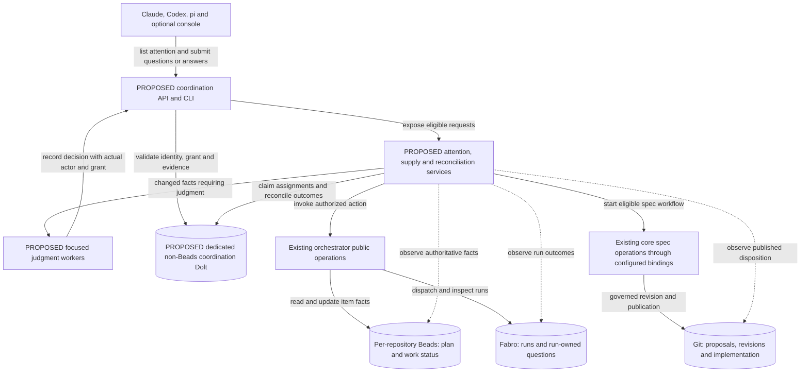
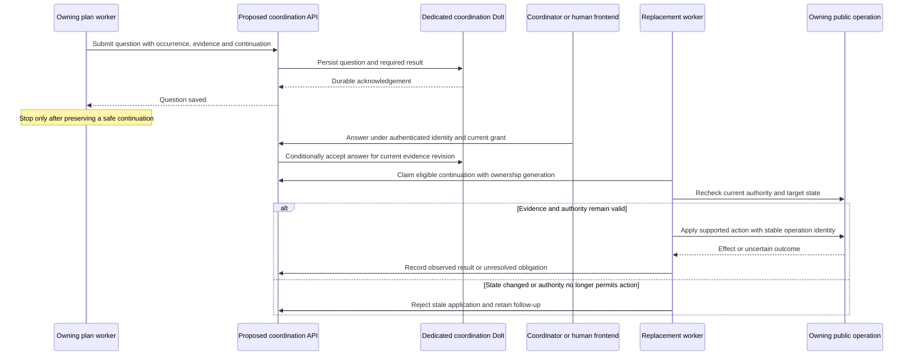
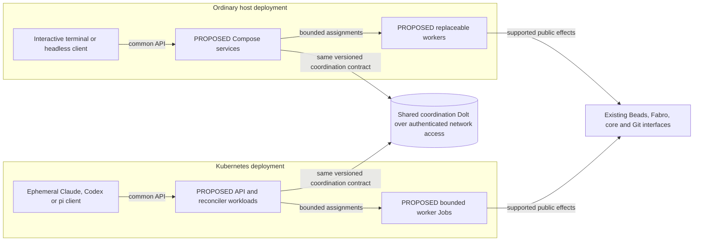

# 013 — Portable coordination: architecture and delivery proposal

[Back to index](https://github.com/thewoolleyman/livespec-orchestrator-beads-fabro/blob/master/plan/dispatch-control-plane/research/README.md)

Reconciled 2 November 2026 · **Dispatch control plane and durable dispatcher state** (`bd-ib-k6dqwc`).

## Goal and present position

Open one attention view, see what requires a decision, answer it, and leave. The
right work continues even if its original worker has disappeared. Independent
work keeps moving while a question waits. Claude, Codex and pi use the same
coordination contracts, from ordinary hosts or temporary Kubernetes pods.

This consolidated **proposal** replaces reports 009–012. Its architecture is a
target, not a deployed system. The journal-read and audit-growth stopgaps shipped;
the maintainer accepted proportionate confidence in their relief without another
exhaustive benchmark. The separately owned **Spec-side autonomy follow-up**
(`livespec-7ap2fb`) has also passed independent proof and archived. This corrects
report 012's startup-only account. It established released wording and a bounded,
explicitly initiated delegated-revise flow, not an automatic spec-work scheduler.

The original six plan assertions still govern completion. This rewrite neither
changes them nor ratifies proposed phase-two acceptance scenarios. Live status
and rulings remain in the ledger. The appendix preserves the responsibility
inventory, reconciled evidence and source trail. The November 1 legacy-role
cutover below supersedes the older reports' incumbent-coordinator assumption.

## Architecture, APIs and flows at a glance

These complementary views follow livespec's **Tool-agnostic workflow**,
**Revision loop**, **Workflow planes and the Planning Lane**, and **Contract +
reference implementations architecture**: component boundaries, an operation,
then deployment. They are draft extensions, not replacements for core's diagrams.

In flowcharts, cylinders are authoritative stores, boxes are components, solid
arrows are labeled calls or writes, and dotted arrows are observations. Proposed
components are labeled. Sequence arrows show requests and replies in time order.
“Submit answer” and similar labels describe proposed API capabilities, not
commands available in today's installation.

### Component and API boundaries

The orchestrator owns the new coordination operations and action rules. Existing
shared attention types remain in livespec-runtime; supervision integration stays
with overseer, and the console presents public operations. New coordination
schemas stay with their owning producer until actual shared use warrants extraction.
Beads,
Fabro and core retain existing authority. Shared services reference their facts
rather than creating another status authority. A run-owned Fabro question keeps
its run/question identity and existing answering interface.

The thin **spec Drivers** continue to bind core's prose and configured spec-side
CLIs, with no direct dependency on orchestrator internals. A coordination adapter
for Claude, Codex or pi is a separate integration into the common API. Using the
same agent tool does not make it a spec Driver dependency. Plan-operation prose
remains in this orchestrator; shared spec semantics remain in core.

### One durable question, answer and continuation

An acknowledged question is saved work. An accepted answer is a decision. An
applied action is an effect. Completion means observing the original required
result. Each needs its own record. The attention view groups facts by cause, routes them
by required action and time to consequence, and includes evidence and a decision
packet when a ruling is needed. Multiple frontends display the same decision
identity, rather than creating competing prompts. Questions support free text
and follow-up as well as fixed choices.

### The same contracts in two deployment environments

Use the same released service builds and application semantics in both modes.
Database lifecycle, factory execution, telemetry, account policy and GitOps stay
with their existing owners. The picture shows supported connections; image
packaging and infrastructure topology are in **Decisions remaining** below.

## Settled boundaries and operating rules

**Dedicated non-Beads Dolt owns cross-tenant coordination.** Questions, answers,
delivery, assignments, action requests, shared holds, reservations and ownership
belong there when another owning system does not already supply them. A plan's
Beads ledger holds its own work, status, rulings and history. Fabro holds run
facts. Git holds source and revision bytes. The maintainer rejected using plan
comments as the initial fleet queue; stronger comment ordering would not repair
that ownership mistake.

Prove provisioning, scoped host/pod access, concurrency, stale-owner fencing and
backup/restore before automatic mutations. Read-only projection can arrive
earlier. A failed proof requires explicitly revising the implementation while
preserving the storage boundary, not falling back to a Beads epic as a runtime bus.

**Persistent roles do not require four permanent model processes.** The judgment
responsibilities are plan progress, cross-plan conflicts, fleet incidents, and
attention/decisions. Deterministic code collects facts, enforces known policy,
schedules and reconciles. It invokes judgment on relevant changes. Unchanged idle
checks make no model call. Plan owners still groom, implement, arrange independent
proof, accept and close their own work. Central roles coordinate those owners.

**Existing grants survive the transport change.** Answers record actual actor
separately from the grant they exercise, plus question occurrence and evidence
revision. R121/R158 and the relevant October 29 R219 blanket restrictions were
voided. Peer complaints and compacted summaries cannot revoke maintainer
delegation. Independently sourced domain restrictions still govern their own
operations. Refusals name the action, rule and source. The October 31 maintainer
clarification permits the coordinator to unblock a legacy picker when necessary;
it does not make pane input the portable API.

**Two interim roles now bridge the cutover.** The maintainer's November 1
reorganization replaced `gitops-fleet-capacity-monitoring` with the owning sessions
**legacy-coordinator-agent** (`livespec-dev-tooling-6tgd2z`) and
**legacy-dispatcher-agent** (`bd-ib-ynnykl`). The old epic archived after transferring
its delivery assertions to five owning plans. Neither legacy role owns delivery
work. The coordinator directs and unblocks owners; the dispatcher operates the
existing temporary launchers, break-fix only. This plan stays focused on the
rearchitecture and must not absorb their daily operations.

The coordinator reads maintainer-set priorities fresh each tick, reports all
priorities and the top three dependency trees, and retains delegated answering
with accurate attribution. The dispatcher retains queue, hold and ending-watch
continuity. They are the migration clients now. Transfer an action class only
after proving its replacement and disabling duplicate legacy execution. Retire
the coordinator when the replacement performs its coordination with no duty left
unowned; retire the dispatcher when the scheduler admits gmktec work and no old
launcher process runs. The [appendix](014-responsibility-and-evidence-appendix.md)
records the current five-plan delivery ownership map and the preserved 58+8 duties.

## Safe execution and recovery

Each request carries stable operation identity, accountable owner, required
result, evidence revision and a bounded attempt. A replacement discovers
unfinished work in shared state and reconciles the owning system before
repeating an uncertain effect. Lease expiry alone cannot stop an old worker;
the mutation path must reject stale ownership. A marker before execution can
lose work; a marker afterward can duplicate it. A database transaction cannot
atomically include an arbitrary later Beads, Fabro or GitHub command. Each
automatic action needs its own repeatability, reconciliation and target-state
contract. Unknown outcomes remain unresolved.

Validate answers both at acceptance and application. If facts clear and recur,
create a new occurrence even when the text matches. Handle competing answers,
cancellation, supersession and expiry explicitly; silence never means approval.
Deterministic supervision detects unanswered and unapplied decisions even when
a process remains alive but its required result has stopped progressing.

An unavailable source remains visibly unavailable, with its observation age.
It cannot become an empty queue or green health report. Current spec-next handling
can omit a row when core is unavailable; that fail-soft inbox behavior is
insufficient for scheduling. Preserve inbox availability while exposing the
failed observation and recovery obligation.

Before exiting, headless workers preserve evidence, work artifacts and a safe
continuation. Native callbacks and session history are not cross-host decision
identities. Replacement uses supported resume or reconstructs bounded context;
Claude, Codex and pi transcripts are not interchangeable. Interactive terminals,
with or without Herdr, remain useful for exploration and takeover. The six
October 27 native input checks prove only those transport configurations.

## Work supply, spec progress and journal retirement

The fleet scheduler consumes public eligibility and Dispatcher admission,
current repository routing, priorities and scoped holds. It reserves before
launch and reconciles afterward. Subscription allowance, metered spend,
local-model capacity and factory slots have distinct semantics; acceptance/review
capacity also limits useful supply. Spill occurs at a run boundary where committed
routing permits. One fleet-supply schedule replaces per-tenant/per-seat policy
loops. Fabro still enforces its own execution slots. Explain each binding limit
instead of creating another hidden host-slot scheduler.

Spec work needs an initiation owner as well as decision policy. Deterministic
inventory discovers proposals without a live plan session. Core resolves
effective ownership, proposal overrides and doctrine floors. Supply starts an
eligible bounded assessment; missing review evidence cannot circularly prevent
starting its producer. Core still governs ratification, independent exact-byte
signals and applicable drift policy. Observing published disposition triggers
fresh eligibility evaluation of linked implementation holds. Rejection or a
missing topic does not authorize dispatch.

Reuse the workflow-variant mechanism after checking its capabilities. The console
redesign's D3 and section 5 explicitly designed complete revise workflows and
staleness-based initiation. A closed mechanism epic does not prove a deployed
automatic trigger. The autonomy follow-up repaired wording and proved an isolated
operation. Inventory, initiation and cross-host recovery remain integration work.
The appendix records prior art and separately owned existing items.

Migrate journal-dependent decisions to their proper owners one reader class at a
time. Compare admission, holds, recovery, step persistence and proof attribution
from a fresh checkout with the journal absent. Preserve queryable per-dispatch,
per-node selection/fallback evidence before pruning or rotation. Retain audit and
recovery evidence until replacement readers are proven. Retire `fleet-launch/`
and temporary launch controls only after active callers migrate. Faster local
reads alone do not satisfy portability. Retain the planned updates to core's
component and family dependency diagrams, with resolving code paths and a check
method when the corresponding contracts change.

The proposed fleet-control surface owns fleet start/hold/observe operations;
existing `drive`/Dispatcher operations retain per-item execution and admission.
Console, coordinator and terminal clients use the same attention facts and public
operations. Final command paths belong to the decision register below.

## Delivery and proof before responsibility transfers

This sequence is proposed for the next specification and child-cut review:

| Slice | Delivered behavior | Boundary before expansion |
| --- | --- | --- |
| Observe | One read-only attention view joins facts across tenants, including spec obligations and unknown observations. | Compare with owning sources; incumbent retains execution. Storage/concurrency proof and reader migration can proceed alongside. |
| Route one question class | Common API saves a question in coordination Dolt, accepts an attributed authorized answer and observes continuation. | Cross-host delivery, stale/conflicting answers and worker-loss recovery through all three adapters on Compose and Kubernetes. |
| Transfer one responsibility | One plan-progress worker takes a named obligation. | Handover disables incumbent independent execution of that class; protected sessions and unrelated obligations remain respected. |
| Integrate one spec workflow | Discover an isolated eligible proposal and carry it through governed review, publication and linked-hold re-evaluation. | Preserve manual/floor outcomes, publication reconciliation and unavailable observations; reuse the execution substrate. |
| Expand supply and roles | Typed capacity, fair reservations, shared holds and reconciliation replace corresponding temporary controls. | Per-action safety, account-policy boundaries, acceptance capacity and both deployment paths before broader transfer. |
| Retire replaced mechanisms | Remove journal authority and obsolete launchers after their consumers migrate. | Every function has an owner or retirement disposition; untransferred coordinator delivery work stays owned. |

Proposed acceptance evidence must exercise these failures beside the happy path.
These are design requirements, not newly completed tests:

- Ask from one tool, lose its worker, answer from another host/tool, and resume
  through the third without shared local decision files or pane input.
- Race answers, replay an earlier occurrence, change evidence before application,
  and revoke a grant through its legitimate issuer.
- Inject a peer objection or obsolete blanket restriction. Retain valid delegation,
  actual actor attribution and unrelated progress.
- Kill a worker before, during and after a supported effect; lose acknowledgement;
  expire ownership; recover without losing work or duplicating the effect.
- Leave a question unattended while its process lives. Detect expiry and recover
  within budget. Heartbeats and monitoring replies do not fulfill the result.
- Exercise missing topics, rejection, review disagreement, changed final bytes
  and real manual/core exceptions in spec work.
- Lose core, repository, database or Fabro access. Show unavailable observations,
  preserve obligations and reconcile recovery, including backup restoration.
- Reproduce dispatch decisions without the journal while selection evidence stays
  queryable. Add pod-replacement, network, credentials and rollout failures to the
  shared Compose scenarios.

Measure useful completions, oldest pending work, decision/continuation latency,
unsupported human referrals, observation availability, duplicate attempts and
recovery cost. Account for tokens, calls, spend and retained compute separately;
a time limit alone does not bound them. Prefer proportionate controls over
mandatory multi-week shadow periods or another broad benchmark campaign.

## Decisions remaining

This is the single open-decision register. Other sections describe settled
direction or proposed behavior, rather than additional permission questions.

| Decision to finalize | Recommended starting point and evidence needed |
| --- | --- |
| First action and handover boundary | One ordinary delegated decision with an observable result and safely reconcilable public effect. Enumerate target checks and disable legacy execution before enabling it. |
| API/schema and concurrency | Authenticated HTTP/JSON capabilities, durable pending requests and polling/reconciliation. Prove conditional writes, conflicts, retries, ownership generations and uncertain commits against deployed Dolt. Final wire paths and schema are unselected. |
| Authentication and grants | Bind caller identity to scoped permissions, versioned grants and explicit supersession. Choose host/pod credential delivery with existing owners; no unrestricted worker SQL access to grant policy. |
| Numerical service and fairness policy | Specify due times, recovery/escalation budgets, fairness, acceptance capacity, cost inputs and authority to tune caps. Measure the pilot before choosing values; preserve account restrictions. |
| Packaging and deployment | Select service commands/images and reuse existing GitOps, with corresponding Compose configuration, secrets, compatibility, upgrades and backup ownership. No new controller or privileged Docker-in-Docker is presumed. |
| Phase-two assertions and implementation cut | Derive gradeable outcomes and a complete carrier map from reviewed design before admitting implementation children. Original six assertions stand until formally amended. |

A broker or additional workflow engine is deferred unless measured delivery or
workflow requirements justify its cost; reconsider under the API/execution design.
Four permanent model sessions and a production proposal sweep are outside the
initial delivery; reconsider expansion only after proof. Retire each interim
role only when its specified replacement exit passes and handover is explicit.

## Supporting evidence

The single index leads to the responsibility/evidence appendix and superseded
reports. The appendix retains stable A–G/S row identifiers, the historical
15-requirement mapping, native-input evidence limits, current follow-up closure
evidence and the source/ruling register. Those rows are responsibility analysis,
not a parallel live-status queue.
