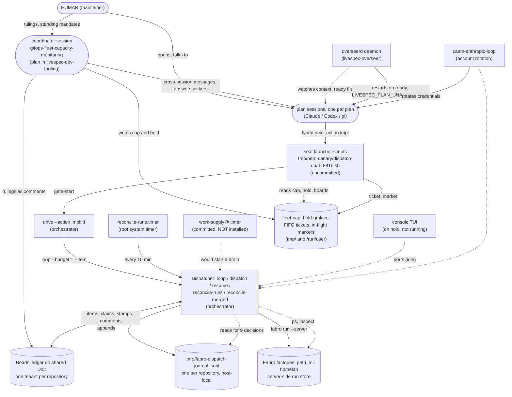
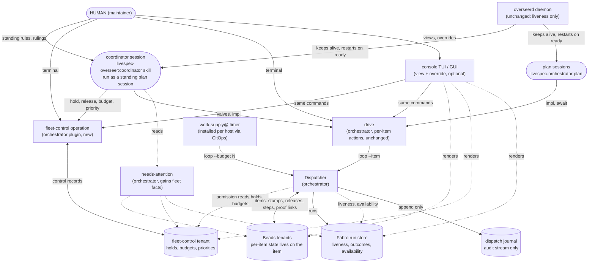
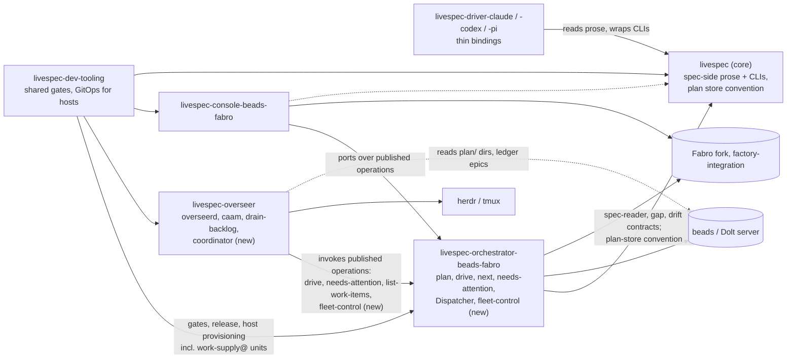
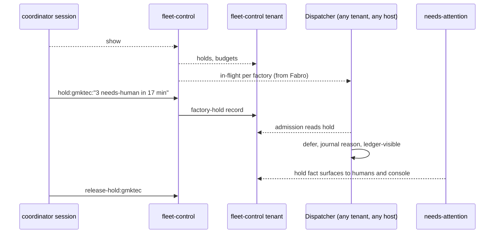
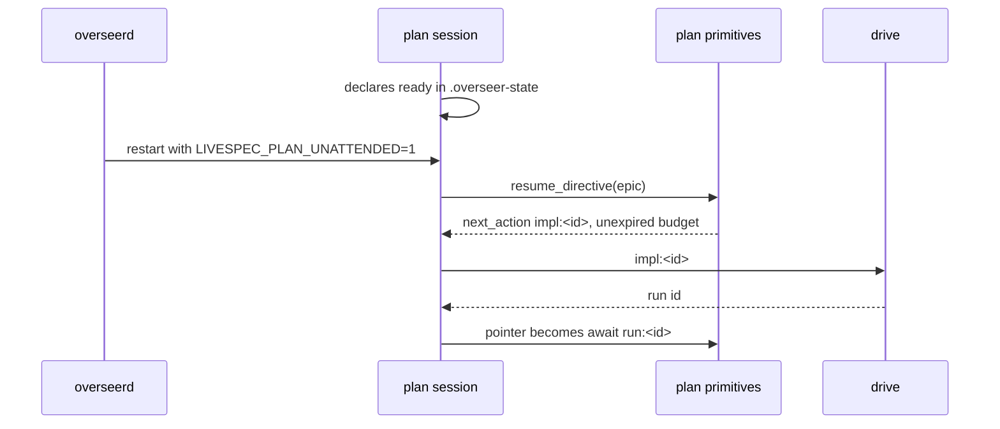
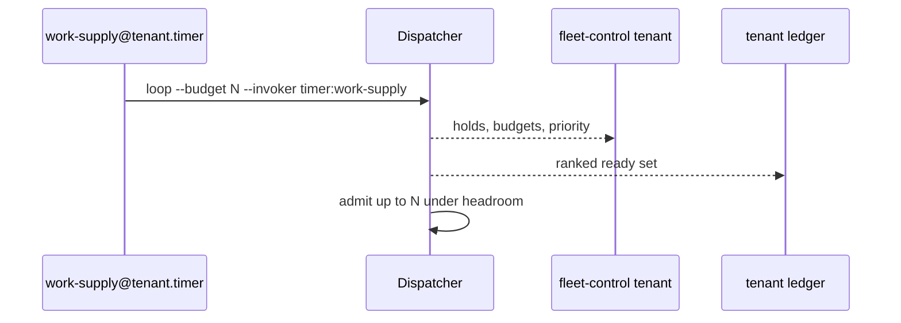

# 008 — First-pass control-plane design draft: where the Dispatcher sits among the overseer, plan sessions, a coordinator and the console

[Back to index](https://github.com/thewoolleyman/livespec-orchestrator-beads-fabro/blob/master/plan/dispatch-control-plane/research/README.md)

**Archived — superseded draft.** Retained to explain the design history. Use reports 009–012 in the index for the current proposed direction; the draft below is not current policy.

Filed 2026-10-25 at the maintainer's direction, unchanged from the withdrawn draft that was written as "004" before note 004 existed. It predates the second pass and both rulings, so research note 004 governs wherever they differ.

Status: DRAFT FOR MAINTAINER DISCUSSION, 2026-10-25. Written by the plan session from research notes 002 and 003
and from the ratified texts cited below. Nothing here is a ruling; §9 lists what the maintainer is asked to decide.

Notation used in every diagram in this note: a solid arrow is an invocation or a write; a dotted arrow is a read
or an observation; a cylinder is a durable store; a rounded box is a human or an LLM session; a plain box is a
deterministic program. Every diagram is a Mermaid block so it renders on the forge and can be checked by eye
against the code paths it cites.

## 1. What the ratified diagrams say today, and where they diverge from the measured reality

### 1.1 Inventory of diagrams across the family (measured 2026-10-25)

| Repository | Diagrams in `SPECIFICATION/` | Other diagram files | Depicts the overseer? | Depicts a coordinator or fleet control? |
|---|---|---|---|---|
| livespec (core) | 7 Mermaid blocks in `spec.md` (`Tool-agnostic workflow`, `Revision loop`, `Workflow planes and the Planning Lane` ×2, `Contract + reference implementations architecture`, two others) | 12 PlantUML sources with rendered SVGs under `archive/research/workflow-processes/diagrams/`, last touched 2026-07-03 | No | No |
| livespec-orchestrator-beads-fabro | 0 | 0 | — | — |
| livespec-overseer | 0 | 0 | — | — |
| livespec-console-beads-fabro | 63 Mermaid blocks across five spec files | 0 | Only as "retired roles" | No |
| livespec-dev-tooling | 0 | 0 | — | — |

There is no family-level dependency diagram anywhere: nothing draws which repository depends on which, or which
plugin's surface another plugin invokes.

### 1.2 What the canonical diagram asserts

livespec core `SPECIFICATION/spec.md` §"Contract + reference implementations architecture" declares its Mermaid
block "the single source of truth". It asserts:

- `CONTROL PLANE: operator console` with the node text "console TUI / GUI: the single human interface", and the
  edge `human ==>|"drives everything via the console"| console`.
- The Dispatcher, Ledger and Loop are `INTERNAL (invisible to core AND Driver)`.
- `plan` is listed among "orchestrator skills" that the console invokes.
- No overseer. No long-lived agent session. No factory host, no Fabro, no journal, no coordinator.

§"The Control-Plane role" adds: "a single operator interface that invokes every plane's skills, shows every plane's
state, and surfaces what needs the human's attention — the standing, event-sourced realization of the orchestrate
skill." §"No required cross-repo loop driver" says the interim `livespec-orchestrate` skill "has been RETIRED: the
reference Beads/Dolt + Fabro orchestrator now realizes the Dispatcher and carries routine cross-repo work
unattended, so no livespec-resident loop-driver skill is needed."

The console's own `SPECIFICATION/spec.md` §"Scope Boundary" goes further: "Every operator-facing capability the
retired `livespec-overseer` roles provided … is realized in the console ONLY as rendering of, and configuration
through, the orchestrator's published surfaces", and "The console MUST NOT host a resident deciding agent".

### 1.3 What is actually running (from notes 002 and 003)

- The overseer is alive, load-bearing, and the thing the maintainer wants to lean into: `overseerd` keeps plan
  sessions alive and restarts them only on their own `ready` declaration, re-kicking from ledger-held plan state.
  Its own prose describes two modes side by side: a factory that "polls the ledger and runs ready work-items
  unattended in Fabro" and "several interactive plan tracks moving in parallel".
- The console is on hold (maintainer, 2026-10-24) and no console process was running. It can dispatch through
  Dispatcher ports, so "the console cannot dispatch" is false, but nothing drives through it today.
- The de facto control plane is a Claude session, `gitops-fleet-capacity-monitoring`, a plan in livespec-dev-tooling
  whose charter calls it "a long-lived standing session" for fleet questions and incidents. It sets the fleet cap and
  factory holds by editing two files under `tmp/petri-canary/`, resolves seats' decision pickers, relays maintainer
  rulings, and reports. Its own driver rules say "Coordinator, not executor".
- Routine cross-repo work is NOT carried unattended: the committed clock-fired `work-supply@` timer is installed on
  no host. Every launch last night came from a seat's uncommitted launcher script wrapping `drive --action impl:<id>`.
- The Dispatcher decides from a host-local journal in nine places (note 002), while the spec since v079 says the
  machine-local journal "MUST NOT be that source — it is absent on a fresh clone, and its absence is silent".

So the canonical diagram is wrong on three counts that matter to this plan: the control plane is not the console,
the plan is not a console-invoked skill but a long-lived supervised session, and a deciding agent exists outside
every drawn box. The foreman and supervisor seats the console spec calls "retired" were removed on 2026-09-06, and
the coordinator took over their fleet-level function within six weeks as an ad hoc plan.

## 2. As-is: the actors and the state they actually touch



Everything inside `fleetfiles` and `journal` is invisible from any other host or checkout. Everything in `ledger`
and `fabro` is reachable from anywhere with credentials.

## 3. To-be: the proposed shape

The principle: **agents and humans drive the factory through the same published surfaces, and every decision reads
and writes stores that are not host-local.** Three human-facing peers sit over one record layer: the coordinator
session acting on the maintainer's behalf, the skill surface for a human at a terminal, and the console for a human
who wants a rendered view. None of them is in another's path.



What changes, in one line each:

1. The Dispatcher's nine journal readers move to the ledger (per item) and the Fabro run store (per run).
2. A `fleet-control` operation in this plugin owns per-factory and per-account control records in a fleet-control
   tenant, and admission reads them. The cap file, hold file and in-flight markers retire.
3. The `work-supply@` timer is installed through GitOps on each operator host, so ready work with no live plan
   session still drains.
4. The coordinator becomes a specified skill in livespec-overseer, run as a standing plan session the daemon keeps
   alive, acting only through `fleet-control`, `drive` and the ledger.
5. The overseer daemon does not change.
6. The console becomes one human front-end among three, and livespec core's canonical diagram says so.

## 4. Repository dependency diagram, as-is and to-be



The direction that decides where `fleet-control` lives: the overseer already depends on the orchestrator's
published operations, and the Dispatcher must read the control records at admission. If the overseer owned the
record schema the orchestrator would depend on the overseer, a cycle. So the orchestrator owns the record contract
and the operation, and the overseer's coordinator skill is a caller. This corrects the plan session's earlier
suggestion that `fleet-control` belongs in the overseer plugin, and answers the maintainer's question about `drive`:
not inside `drive`, which is per item, but a sibling operation in the same plugin.

## 5. The coordinator skill (livespec-overseer), in detail

**What it is.** One fleet-wide LLM seat that keeps a holistic view, acts on the maintainer's behalf to unblock and
prioritise, and raises only what is genuinely the maintainer's. It is the foreman's function at the scope that
worked (one per fleet, not one per repository) with the coordinator's measured discipline.

**How it runs.** As a standing plan session: a plan epic in the overseer tenant anchors it, its handoffs and rulings
are ledger comments through the plan primitives, and `overseerd` keeps it alive and restarts it on `ready` exactly
as it does any plan session. The coordinator skill prose supplies the tick discipline on top of the plan operation;
it does not replace it. This is the drain-backlog model, "the session IS the loop", applied to the whole fleet.

**Inputs each tick (all through published surfaces, never files):**

| Input | Surface | Today's equivalent |
|---|---|---|
| Items needing a human, holds, capacity residue, stranded claims | `needs-attention` per tenant | same, plus reading pane text |
| In-flight runs per factory and tenant, failures and their causes | `fleet-control show` (from the Fabro run store and ledger stamps) | `fabro ps`, boards, `fabro inspect` by hand |
| Active holds, budgets, priorities and who set them | `fleet-control show` | `tmp/petri-canary/fleet-cap`, `hold-gmktec` |
| Account headroom | caam's published selection record | same |
| Plan progress and stalls | `diagnose-plan-progress`, plan timelines | same |
| Standing maintainer rules | a committed coordinator policy document plus scope events on its epic | R-numbered rulings in ledger comments |

**Actions (the whitelisted actuator is the ordinary skill surface):**

| Action | Through | Replaces |
|---|---|---|
| Set or release a factory hold with reason and release condition | `fleet-control` | creating or deleting `hold-gmktec` |
| Set an account or factory budget | `fleet-control` | editing `fleet-cap` |
| Reorder priority across plans | `fleet-control` priority record, read by `next` and admission | prose mandates relayed to seats |
| Dispose a valve, admit, dispatch, resolve blocked | `drive` | the same, plus answering pickers in panes |
| Record a ruling or deferral | plan scope event on its own epic | ledger comments |
| Wake or instruct a seat | `SendMessage` | same |
| Raise to the maintainer | one non-blocking line in its report | same |

**Constraints carried over from the foreman and from the coordinator's own rulings:** never a blocking prompt;
bounded tick; every mutation through a published operation so it is journaled and attributable; `report-only`
versus autonomy as committed configuration, never assumed; never answers another seat's tool-permission prompt;
reads scope events before handoffs; audits idle capacity before writing that nothing can use it.

**What it must shed over time, and to whom.** The specification should list each judgement the coordinator makes
by hand today beside its deterministic successor, so the seat shrinks as mechanisms mature:

| Manual judgement today | Deterministic successor |
|---|---|
| Hold a factory after N needs-human runs in T minutes | an auto-hold rule in `fleet-control`, with the coordinator releasing |
| Lower the fleet cap under load | account headroom gate (already in admission) plus Fabro's own `max_concurrent_runs` |
| Find stale `blocks` edges and released-but-open items | `reconcile-merged` and a hygiene fact in `needs-attention` |
| Audit idle slots against dispatchable work | the `hygiene:capacity` fact (already specified) |
| Resolve seats' decision pickers | plan continuation rulings and the unattended-resume contract |

**Relation to overseerd.** The daemon already carries "Independent recovery of authorized session obligations":
deterministic, no model calls, bounded recovery through the orchestrator's public interface. That is the right
split. The daemon does what needs no judgement; the coordinator does what does; neither selects ready work, which
is the Dispatcher's.

## 6. The fleet-control operation (orchestrator plugin), in detail

**Records.** Three kinds, keyed by what they are about rather than by tenant:

| Record | Key | Fields | Written by | Read by |
|---|---|---|---|---|
| factory hold | factory name | reason, owner, set_at, release_condition, released_at, released_by | coordinator, human, auto-hold rule | Dispatcher admission, `needs-attention`, console |
| budget | provider account or factory | kind (in-flight count or headroom floor), value, set_by, until | coordinator, human | Dispatcher admission |
| priority | fleet | ordered list of plan epics or tenants, set_by, until | coordinator, human | `next`, admission ordering |

**Home.** A fleet-control tenant on the shared Dolt server, named in each repository's committed `.livespec.jsonc`
so that any tenant's Dispatcher resolves it the same way on any host. Realised as ledger items with typed metadata,
the way plan epics already carry typed `next_action`. One mechanism caveat for the implementing child: `bd` resolves
its tenant from the working directory, so the reader needs an explicit connection, not a `cd`.

**Actions.** `hold:<factory>:<reason>`, `release-hold:<factory>`, `set-budget:<scope>:<value>`,
`set-priority:<ordered-list>`, and `show`, which renders in-flight runs per factory and tenant from the Fabro run
store joined to ledger stamps, active holds and budgets, the last admission pass per tenant, and the last
`work-supply` firing per host. `show` is the fleet view the coordinator and the console both consume.

**Dispatcher side.** Admission reads holds and budgets before the three conditions it already owns, refuses or
defers with a journaled, ledger-visible reason naming the record, and never writes these records itself except
through an auto-hold rule the specification names. Per-host concurrency stays Fabro's per v053.

**What v053 does and does not permit.** §"Host concurrency belongs to the Fabro scheduler" forbids the Orchestrator
any host-level concurrency limit, gauge or lock. A factory hold is a health switch, not a concurrency limit, and an
account headroom floor is already in admission. A fleet-wide in-flight COUNT is the one thing that brushes v053.
Recommendation: do not carry the count forward; the hold plus headroom plus Fabro's own ceiling cover its uses.
If the maintainer wants the count kept, it is a spec-change-tier decision routed through propose-change.

## 7. Sequences

### 7.1 A plan session dispatches a child (to-be; differs from today only in where state lands)

```mermaid
sequenceDiagram
    participant S as plan session
    participant D as drive
    participant X as Dispatcher
    participant F as fleet-control tenant
    participant L as item tenant
    participant R as Fabro
    S->>D: impl:<id>
    D->>X: loop --budget 1 --item <id>
    X-->>F: read holds, budgets, priority
    X-->>L: read item, claims, prior releases
    X-->>R: liveness of any prior run
    X->>L: stamp dispatch id, run id, factory
    X->>R: fabro run --server
    X->>S: result (run id) ; next_action becomes await run:<id>
```

### 7.2 The coordinator holds a factory



### 7.3 Unattended continuation after a restart



### 7.4 Work with no live plan session



## 8. The console's role, answered

Agents never drive through the console. The coordinator and the plan sessions invoke `drive` and `fleet-control`
directly; the console's own specification already forbids it from being anything but a renderer and a recorder of
explicit human commands over the orchestrator's surfaces. What is left for the console is therefore exactly what
its spec says and nothing more: a human view across tenants with history, and a place for a human to issue the same
commands the skill surface offers. That is a legitimate product, and it is optional. Three dispositions:

- **A. Keep it as a peer front-end and say so in core.** Change livespec core's canonical diagram and §"The
  Control-Plane role" from "the single human interface" to one human front-end among the coordinator seat, the skill
  surface and the console. Build nothing in the console now. Cost: one propose-change in livespec core.
- **B. Retire the console.** The coordinator plus `needs-attention` and `fleet-control show` become the UX. Cost:
  a plan in the console repository; loses the event-sourced history and the future GUI.
- **C. Leave it on hold and the diagram as is.** Cost: the canonical diagram keeps asserting something false, and
  every new reader is misled the way this plan's own charter was.

Recommendation: A now, because it is cheap and removes the false claim; revisit B or a GUI after the coordinator
skill exists and its attention cost is measured.

## 9. What the maintainer is asked to decide

1. Confirm the to-be shape of §3, or name the box that is wrong.
2. `fleet-control` as a new orchestrator-plane operation (not inside `drive`, not in the overseer), per §4.
3. Drop the fleet-wide in-flight count in favour of hold plus headroom plus Fabro's ceiling (§6), or keep it and
   route a v053 change through propose-change.
4. The coordinator as a specified livespec-overseer skill run as a standing plan session (§5), and whether this
   plan carries its specification as a child through the cross-tenant execution mirror, which the maintainer has
   asked for rather than a sibling plan.
5. Console disposition A, B or C (§8).
6. The Definition of Done amendments below.

## 10. Proposed amendments to this plan's Definition of Done

The six existing assertions stand. Proposed additions, each to be confirmed and then carried in the carrier map:

- The specification of this repository names a fleet-control record contract (holds, budgets, priorities), its
  home in a fleet-control tenant, and the Dispatcher's admission reads it; no launcher or seat reads a cap or hold
  file.
- A `fleet-control` operation exists in this plugin with hold, release, budget, priority and a fleet view, and
  `needs-attention` surfaces active holds and budgets as facts.
- The clock-fired work supply is installed on each operator host through livespec-dev-tooling's GitOps, and ready
  work with no live plan session is admitted by it.
- livespec-overseer's specification names a coordinator skill with its inputs, actions, tick discipline, autonomy
  configuration, and its relation to overseerd, the plan operation and drive; the gitops-fleet-capacity-monitoring
  session is retired onto it or its retirement is recorded.
- livespec core's canonical architecture diagram and this repository's specification carry a current component
  diagram and a family dependency diagram that name the overseer, plan sessions, the coordinator, the console as one
  front-end, and the Dispatcher's state homes, and each diagram cites the code paths it depicts.

These are host-captured by default like every plan assertion. The diagram assertion needs a stated check method
at filing time, or it will be judged by eye; the implementing child should name one.
