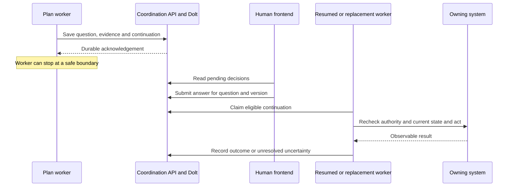

# 010 — Plan sessions in Herdr and headless workers

[Back to index](https://github.com/thewoolleyman/livespec-orchestrator-beads-fabro/blob/master/plan/dispatch-control-plane/research/README.md)

> Retired 2 November 2026. This dated record is superseded by proposal 013 and appendix 014, linked from the single index. Its open questions and observations are historical.

Research and recommendation · 27 October 2026

Plan: **Dispatch control plane and durable dispatcher state** (`bd-ib-k6dqwc`).

## Recommendation

Keep interactive terminals—including Herdr—as useful places to discuss a plan,
inspect work and take over a session. Herdr is optional: all three agents also
accept questions and answers as bare interactive processes. Make routine plan
execution possible through headless workers. In both
cases, save outstanding decisions outside the worker so they can be answered
from another host and survive losing the original process.

For this plan, that shared coordination belongs in the **dedicated non-Beads Dolt
database**, as already decided. A plan's own status and rulings remain in its
Beads ledger; factory run facts remain in Fabro. This research does not reopen
that boundary. See the [corrected direction report](009-portable-coordination-research-summary.md).

Do not convert every planning conversation into short jobs immediately. Start
with one well-defined responsibility and its question/answer flow. A useful
human conversation can stay open while its execution workers come and go.

## How does a headless session wait for a person?

It needs an input channel supplied by its host application. Removing the terminal
does not create that channel, and redirecting stdout to a log is insufficient.
There are three materially different approaches:

| Approach | What happens while the person decides | What resumes it | Main limitation |
| --- | --- | --- | --- |
| Interactive session, bare or in Herdr | The agent process waits at its normal prompt. | Input through its terminal. | Native prompt and process state remain tied to that session. |
| Headless session with a live adapter | A tool callback, promise or protocol request waits. | The adapter sends a structured response carrying the request ID. | The waiting call may exist only in process memory. |
| Durable pause with a replaceable worker | The application saves the pending decision and continuation; execution stops at a safe boundary. | A saved answer makes the work eligible for a worker to resume. | Requires explicit recovery, context and side-effect rules. |

There is also a fourth behavior: a one-shot command can **stop with an input or
permission error**. That is useful for automation, but it is not a pending question
unless the surrounding application creates one. Do not mistake successful process
exit for successful work, or an indefinitely open stdin pipe for a human gate.

For the proposed durable path:

1. The worker encounters a decision it cannot make under its existing grant.
2. It saves the question, evidence version, permitted answerers, affected work and
   continuation reference through the coordination API. The save must succeed
   before it reports that the question is waiting.
3. It leaves that responsibility waiting for an answer. Other authorized work can
   continue. The worker may finish after preserving the required state; it does
   not need to keep an LLM generating or polling.
4. The human answers through a shared view, terminal client or other supported
   frontend. The service authenticates the answerer, records the answer against
   that question/version, and makes the continuation discoverable.
5. A worker claims the continuation, checks current evidence and authority, and
   applies the supported action. It then observes the result before marking the
   obligation fulfilled.

A notification can make this faster, but periodic reconciliation must recover a
missed notification. Saving an answer and scheduling its consumption must not
leave an unrecoverable gap. An answered question is not yet an applied action.

This is a proposed application design, not an assertion that an arbitrary Claude,
Codex or pi call stack can be serialized into Dolt. We can resume native session
history where available, or start a replacement with explicit context. Neither
option restores an old in-memory callback automatically.



## What Herdr gives us, and what it does not

Herdr keeps panes running in a background server when the client detaches. A phone
or another machine can reconnect. That already solves the common problem of an
SSH connection dropping while an agent is working. A full server restart is
different: processes stop, layout can return, and supported agents can resume
using native session references. Replayed screen history is not a restored
process. [Herdr persistence](https://herdr.dev/docs/persistence-remote/),
[session restoration](https://herdr.dev/docs/session-state/).

It would therefore be inaccurate to call Herdr sessions disposable whenever the
UI closes. It would be equally inaccurate to equate their persistence with a
cross-host decision queue. Native conversation recovery does not establish that
an outstanding approval is still valid or that its effect happened once.

Our current overseer deliberately relays a tracked session's question without
opening another blocking prompt. It tells the human to answer in the owning
pane. That policy followed an actual failure: the original question was answered
while a duplicate modal kept the overseer blocked. Its specification also allows
an explicit blocked declaration when no suitable structured question is available.
These are current contracts, not evidence that headless sessions cannot ask.
[Overseer prose at inspected revision](https://github.com/thewoolleyman/livespec-overseer/blob/e22a67a7b09ff9dcb921e5c11916c418d03272e9/.claude-plugin/prose/overseer.md),
[supervision specification](https://github.com/thewoolleyman/livespec-overseer/blob/e22a67a7b09ff9dcb921e5c11916c418d03272e9/SPECIFICATION/spec.md).

Our repository's later maintainer guidance also tells plan sessions to route
unresolved choices to the fleet coordinator and use its delegated answers rather
than repeatedly prompting the human. That delegation must survive the transport
change. The pane-based overseer instructions describe the existing presentation
path; they do not revoke coordinator authority. The mismatch is another reason
to formalize answer routing instead of copying terminal behavior into a service.
[Plan-session guidance](../../../../.ai/plan-session-lessons.md).

The replacement should preserve **one decision owner**, while allowing multiple
views of that same decision. Multiple clients showing one question ID are useful;
two independent prompts with separate answers are not. Moving answer authority
out of the pane requires a deliberate contract change and handover.

## Tradeoffs for our plans

| Concern | Interactive Herdr session | Headless execution with durable decisions |
| --- | --- | --- |
| Exploring an unclear goal | Strong: immediate back-and-forth, native tools and visible context. | Possible through a client, but a crude form or job submission is a worse conversation. |
| Routine continuation | Works, but supervision must interpret the session lifecycle. | Fits bounded jobs, explicit inputs and machine-readable outcomes. |
| Answering from a phone | Existing remote access works; many panes and prompts can be cumbersome. | A shared queue can gather decisions with compact evidence; that UI must be built. |
| Host or pod replacement | Depends on recoverable files, native resume and restored environment. | Portable if decision records, artifacts and necessary session state are outside the pod. |
| Cost while waiting | An idle prompt does not inherently generate tokens; its process and environment remain allocated. | A saved pause can release worker resources. Live headless callbacks still retain a process. |
| Context continuity | Keeps the immediate conversation available until compaction or restart. | Rehydration can lose nuance and incur startup, token and cache costs. |
| Visibility and takeover | Direct terminal inspection and intervention are convenient. | Needs good event logs, artifacts and an explicit attach/takeover path. |
| Maintenance | Reuses mature agent UIs, but screen-dependent automation is fragile. | Structured APIs are clearer, but we own protocol adapters, schema changes and recovery. |
| Concurrency | More panes do not themselves prevent conflicting decisions. | Shared claims can enforce ownership, provided stale workers are fenced at mutation. |
| Deployment | A persistent host is straightforward; live terminal state complicates disposable pods. | Natural fit for Jobs and Compose workers, but credentials and writable state still need a design. |

There is no measured local cost or throughput comparison establishing a universal
winner. Count useful completed work, human handling time, unanswered-decision age,
restart loss, duplicate effects, total model usage and retained compute—not panes
or worker count alone. A planning conversation with frequent human replies may be
better left warm. A worker awaiting a decision overnight usually has much less
reason to retain its execution environment.

## What other factories actually do

These are different strategies, not votes for a single architecture. Product
documentation establishes a supported interface; it does not establish recovery
behavior that the documentation never promises.

### Stripe Minions: avoid mid-run conversation for bounded work

Stripe describes a typical run starting from a Slack request and ending in a PR
ready for review, with no interaction in between. Developers can still plan with
interactive agents, then give a Minion a bounded task. They can provide further
instructions after a run. This supports separating interactive planning from
unattended implementation; it does not prove open-ended planning should have no
questions. [Stripe's engineering account, 9 February 2026](https://stripe.dev/blog/minions-stripes-one-shot-end-to-end-coding-agents).

### OpenAI Symphony: make the input policy explicit

Symphony runs tracker-selected work through agent sessions and permits handoff at
a human-review state. Its specification requires implementations to handle input
and approval requests rather than stall indefinitely. Allowed policies include
operator routing or failing the run; its high-trust example fails input-required
turns immediately. This is not an out-of-the-box durable clarification queue.
For our plans, repeated retries of the same unanswered question would be the wrong
interpretation of that failure behavior. [Symphony specification, sections 1 and 10.5](https://github.com/openai/symphony/blob/main/SPEC.md).

### Factory Droid: distinguish one-shot commands from an application session

`droid exec` supports a one-shot mode that stops on permission violations, and
also documents a bidirectional JSON-RPC mode. Factory's TypeScript SDK exposes
`askUserHandler` for questions and a separate permission handler. A missing
AskUser handler declines the request. An application supplies its own form or
other UI; headless does not mean there is no user interaction. These callback
contracts do not, by themselves, prove recovery of a pending callback after its
host dies. [Droid Exec](https://docs.factory.com/droid-exec/overview),
[Droid SDK](https://docs.factory.com/sdk/typescript).

### Devin: address the session through an API

Devin's session API distinguishes working, waiting for user input and waiting for
approval. Its message endpoint accepts messages addressed to a session and says
it automatically resumes a suspended session. A terminal is not the address for
the reply. This is useful prior art for an external attention client, but the
inspected endpoint does not establish our required evidence-version checks or
exactly-once external effects. [Get Session](https://docs.devin.ai/api-reference/v3/sessions/get-organizations-session),
[Send a message](https://docs.devin.ai/api-reference/v3/sessions/post-organizations-sessions-messages).

### Gas Town: structured escalation with a different storage choice

Gas Town documents severity-based escalation through Deacon, Mayor and human
Overseer, including acknowledgement and stale re-escalation. It uses Beads for
those records. Category-based routing is explicitly marked future work. We can
learn from its escalation ownership and aging without adopting its storage
choice: our cross-tenant coordination remains in dedicated Dolt. Notification
and acknowledgement are not substitutes for a recorded decision and verified
result. [Gas Town escalation design](https://github.com/gastownhall/gastown/blob/main/docs/design/escalation.md).

### Our Fabro checkout: an existing interview boundary worth reusing

Fabro supports human gates and agent questions through interview abstractions.
The inspected server exposes pending questions by run and an authenticated
`/runs/{id}/questions/{qid}/answer` endpoint. It checks the pending question,
validates the answer and delivers it to the run. The code includes projected
pending-interview records and worker-control reconnection handling, beyond the
simpler web-queue description in its docs.

The active `ControlInterviewer` still waits through in-memory channels. That fact
alone does **not** mean all interview history is volatile; conversely, a persisted
projection does not prove transparent resumption of every interrupted worker.
Worker replacement, late delivery and uncertain action outcomes need explicit
acceptance tests against the deployed build. Do not infer the entire durability
contract from either the channel or the database in isolation.

Reuse or adapt this run-level input surface for questions Fabro owns. The fleet
coordination service should reference the run/question identity and its outcome,
not create a competing approval authority for the same run. Our plan-level and
cross-tenant decisions still need their own shared records.

Inspected local fork revision: `3b37818887c8daf80bbb28fb6e30056a32b22db1`.
[Interviews](https://github.com/thewoolleyman/fabro/blob/3b37818887c8daf80bbb28fb6e30056a32b22db1/docs/public/human-tools/interviews.mdx),
[run endpoints](https://github.com/thewoolleyman/fabro/blob/3b37818887c8daf80bbb28fb6e30056a32b22db1/lib/apps/fabro-server/src/server/handler/runs.rs),
[answer delivery](https://github.com/thewoolleyman/fabro/blob/3b37818887c8daf80bbb28fb6e30056a32b22db1/lib/apps/fabro-server/src/server.rs),
[active interviewer](https://github.com/thewoolleyman/fabro/blob/3b37818887c8daf80bbb28fb6e30056a32b22db1/lib/components/fabro-interview/src/control.rs).

### LangGraph and Temporal: durable waiting as a workflow operation

These are workflow frameworks, not factory throughput evidence. LangGraph's
interrupt saves state through a checkpointer and returns a payload. An external
response resumes the same thread. A durable backend is required for restart
survival, and resumption reruns the interrupted node from its beginning: earlier
side effects must tolerate replay. [LangGraph interrupts](https://docs.langchain.com/oss/python/langgraph/interrupts).

Temporal documents Signals and Updates, with workflow conditions that wait for
input. It also warns about concurrent handlers and unfinished handlers when a
workflow completes. The useful lesson is to model waiting and message handling
explicitly. Neither framework removes the need for application authorization,
stale-answer rejection or idempotent external operations. This research does not
justify adding another workflow engine to the existing factory.
[Temporal message passing](https://docs.temporal.io/develop/typescript/workflows/message-passing).

## Claude, Codex and pi need different adapters

A product saying it supports headless execution is not enough. We need to prove
question creation, answer delivery, cancellation and recovery for the exact mode
and version we deploy. Tool permission, a clarification question and a plan-level
business ruling are distinct kinds of input; broad shell permission does not
answer an architectural question.

| Harness | Documented input mechanism | Consequence for our integration |
| --- | --- | --- |
| Claude Agent SDK | `AskUserQuestion` reaches the application's `canUseTool` callback; the application displays questions and returns answers. | Route questions explicitly. Do not assume every permission mode calls the callback, or that every subagent can ask directly. |
| Codex app-server | Structured input and approval requests have thread/turn/request context; the client responds over the protocol. | Correlate the response with the live request and our durable question. A request being cleared is not proof that an answer was applied. |
| pi RPC | `extension_ui_request` for a dialog waits for `extension_ui_response` with the matching ID. | Implement an extension/client bridge. Custom terminal widgets are not generally available in RPC mode. |

Sources: [Claude input handling](https://code.claude.com/docs/en/agent-sdk/user-input),
[Codex app-server](https://developers.openai.com/codex/app-server/),
[pi RPC dialogs](https://github.com/earendil-works/pi/blob/main/packages/coding-agent/docs/rpc-extension-ui.md).

Codex documents `exec resume` for continuing a non-interactive session, but that
is a later invocation, not proof of a live question callback. Its app-server
also emits `serverRequest/resolved` when a request is cleared by interruption or
turn lifecycle changes. Treating that event as “the human approved” would be
incorrect. [Non-interactive continuation](https://developers.openai.com/codex/noninteractive/),
[request lifecycle](https://developers.openai.com/codex/app-server/).

For any adapter, retain a durable coordination ID separately from a temporary
harness request ID. A native session ID may also depend on local history files.
Cross-host recovery requires making the needed history/artifacts available, or
reconstructing a bounded prompt from authoritative records. Switching between
Claude, Codex and pi cannot assume their internal transcripts are interchangeable.

## Live checks: three agents, two modes, no Herdr

The original report verified only pi RPC. On 27 October 2026 we expanded that
into **six successful input-transport checks** on this host. No test used Herdr,
tmux, an existing pane, or a production plan session. Interactive tests launched
the actual CLIs directly under fresh pseudo-terminals, with a small controller
sending keystrokes and recording their screens. A pseudo-terminal provides the
ordinary terminal interface; it does not provide session persistence or question
routing. Headless tests used pipes and each agent's structured interface.

| Agent and installed version | Bare interactive process | Headless process |
| --- | --- | --- |
| Claude Code 2.1.311 | Native `AskUserQuestion` picker appeared; we selected the second option, Violet; Claude returned `RECEIVED_COLOR=Violet`. | Agent SDK 0.3.311 launched that same installed CLI. Its `canUseTool` callback received the question, held the answer for three seconds, returned Violet, and received the same final result. |
| Codex CLI 0.164.0 | Native question picker appeared in Plan mode; we selected Violet; Codex displayed the accepted answer and returned `RECEIVED_COLOR=Violet`. | App-server emitted `item/tool/requestUserInput` with `isBlocking: true`; after a three-second hold, the matching JSON-RPC response supplied Violet; the turn completed with the same final result. |
| pi 0.84.4, Node 24.20.0 | The explicitly loaded test extension displayed a native Yes/No picker; Enter selected Yes; the handler continued with `probe-result:true`. | The same extension emitted an identified `extension_ui_request`; after a three-second hold, the matching response supplied `confirmed: true`; the handler continued with `probe-result:true`. |

Claude and Codex used real model-issued tool calls. Claude's interactive banner
identified Opus 5.5; Codex used the configured GPT-6-Astra model in both paths.
Pi's two checks deliberately exercised its extension dialog without calling a
model. They prove the extension input path in both modes, not that a model will
choose an appropriate question or that a Livespec package is installed correctly.
The isolated pi config had no provider login, which did not prevent its dialog.

For each interactive check we first observed the unanswered picker, then sent
input, then observed the returned answer. Claude's displayed question remained
unanswered for about eleven seconds between screen inspection and selection;
Codex's for about nine seconds. Pi was answered within its explicit ten-second
test timeout. Each process was then terminated by its own test controller.

A [compact evidence receipt](../evidence/input-verification-receipt.json) preserves request
identities, selected answers, timestamps where recorded, and terminal excerpts.
The temporary controllers also captured raw terminal logs locally; those noisy
logs are not the published report or a durable coordination store.

### What was actually sent

Claude's callback received `AskUserQuestion` with tool-use ID
`toolu_0185GmA1HgKpkNSL2tic1Zyc`. It returned:

```json
{
  "behavior": "allow",
  "updatedInput": {
    "questions": "<the original questions array, preserved unchanged>",
    "answers": {"Which probe color?": "Violet"}
  }
}
```

The placeholder above abbreviates the original array; the receipt carries the
real question. The SDK result was `success`, `is_error: false`, with the selected
color in the final response. Only `AskUserQuestion` was exposed as a built-in
tool. The CLI ran in safe mode, with customizations disabled and manual/default
permission handling rather than bypass permissions.

Codex's app-server request had JSON-RPC ID `0`, question ID `probe_color`,
thread ID `01a17ebb-1ca0-7f90-933c-ecd5d53c2d8c`, and a separate turn and item ID.
The controller answered:

```json
{"id":0,"result":{"answers":{"probe_color":{"answers":["Violet"]}}}}
```

This was an app-server process, not `codex exec` with an open stdin. The
controller initialized the protocol with `experimentalApi: true`, started an
ephemeral read-only thread, and started the turn in Plan mode. Both Codex tests
used `approvalPolicy: never` / `-a never` for command permissions, yet the
clarification question still worked. **Command approval and conversational
input are separate mechanisms.** This does not establish behavior in every
collaboration mode or permission configuration.

Pi registered this minimal extension command:

```ts
pi.registerCommand("research-input-probe", {
  handler: async (_args, ctx) => {
    const answer = await ctx.ui.confirm(
      "Research probe", "Use the synthetic answer?", { timeout: 10000 });
    ctx.ui.notify("probe-result:" + String(answer), "info");
  }
});
```

The repeated RPC check recorded:

```text
stdout: extension_ui_request, method=confirm, id=4784ead9-915c-471a-8f4b-6542c9db526f
        [controller withholds answer for three seconds]
stdin:  extension_ui_response, same id, confirmed=true
stdout: extension_ui_request, method=notify, message=probe-result:true
```

Both pi launches used `--no-session --no-extensions --no-skills
--no-prompt-templates -e <probe.ts>` and an isolated configuration directory.
The headless launch additionally used `--mode rpc`. The controller checked command
registration before invoking it and observed no model-message start in RPC mode.

### Startup findings and limits

The initial pi launcher used Node 20.19.4, which lacked the required `node:fs`
export `globSync`. Using the already installed Node 24.20.0 resolved startup.
Pin and test the complete worker runtime, not just the agent package.

Codex's bare terminal showed a changed-hook trust prompt. We selected **continue
without trusting**, and the subsequent turn reported that the unapproved hook did
not run. The native question still succeeded. This is evidence about Codex's own
input path, not a successful test of the host's installed Livespec hooks. Existing
MCP servers and apps were disabled for the Codex probes; global configuration was
not rewritten. Claude safe mode likewise excluded customizations. No agent was
authorized to modify a repository or execute an external action during the probe.

The six checks establish that these versions can wait for and consume input in
the tested configurations, without Herdr. They do **not** establish cross-host
answer delivery, stale-answer rejection, concurrent-answer handling, process-loss
recovery, container/Kubernetes deployment, Livespec plugin operation, or an entire
plan's completion. Those remain separate acceptance tests.

There is also a useful qualification to the earlier durability discussion:
Claude's current SDK documentation describes a `PreToolUse` **defer** decision
that lets a process exit and later resume the pending tool from its saved session.
That deserves evaluation before inventing a replacement native-resume mechanism.
We did not test defer here, and it does not by itself establish shared answer
ownership, evidence freshness, or portability across all three harnesses.
[Claude input and deferred-tool guidance](https://code.claude.com/docs/en/agent-sdk/user-input).

## Bare interactive processes are a real third option

Interactive versus headless and managed versus bare are different choices. A
bare Claude, Codex or pi process can ask a question directly in an ordinary
terminal; the tests above establish that. Herdr is not required to make planning
interactive, and removing it does not require moving immediately to headless jobs.

| Setup | Where a person answers | What keeps a waiting process available |
| --- | --- | --- |
| Bare interactive CLI | The agent's own terminal picker or conversation | The terminal/host arrangement; the probe supplied no detach or restart service. |
| Interactive CLI in Herdr | The same agent UI, presented in a managed pane | Herdr's background session management, subject to the restart limits above. |
| Headless CLI/SDK worker | A client that translates structured requests and replies | A live process, or an explicitly saved continuation with a recovery mechanism. |

A plain terminal can be the simplest choice for attended planning. Herdr adds
convenient supervision and reconnection when those matter. A container can run an
interactive process if it has a terminal attached; containerization alone does
not imply headless operation. For unattended or disposable workers, prefer the
structured input path and saved coordination state. All three frontends should
ultimately show and answer the same durable question when shared routing is added.

## Proposed first delivery and its limits

Use the existing `gitops-fleet-capacity-monitoring` session as the first client,
following the [already agreed coexistence stages](009-portable-coordination-research-summary.md#coexisting-with-the-current-coordinator).
Keep its obligations and current grants. Start in observation mode; route one
question class; then explicitly transfer one responsibility. Disable the
incumbent's independent execution of that responsibility before enabling the new
worker's execution.

For a short human interaction, keeping a native callback warm is reasonable. For
long or unattended waits, prefer a saved decision and a resumable execution
boundary. Do not kill a worker merely because a question appeared: first preserve
uncommitted work, evidence, the continuation and any uncertain effects. If that
boundary cannot be captured safely, keep the bounded live wait or report the
limitation. “Ephemeral” must not mean “discard what we have not saved.”

The shared service should support free text and follow-up discussion as well as
fixed choices. A person answering a complex plan question needs the evidence and
context, not just an approve button. Herdr can remain the place for that richer
conversation, while the resulting decision is recorded through the same API.

Before switching a responsibility, demonstrate:

- Ask in one harness; answer on another host; resume with a different worker.
- Kill the original worker before the answer. The question remains discoverable.
- Submit two answers concurrently and replay an answer from an earlier occurrence.
  Only the currently authorized decision can take effect.
- Lose the acknowledgement after a successful write or action. Reconcile without
  losing the answer or repeating an irreversible effect.
- Cancel or supersede a question, or let its policy deadline expire. Do not turn
  silence into approval or retry a human gate as though it were a network error.
- Keep unrelated work moving and avoid model calls while no relevant fact changes.
- Exercise common behavior in Compose and Kubernetes, then pod replacement and
  deployment-specific failures separately. Preserve existing spending constraints.

Keep common coordination logic and the three harness adapters centrally owned
and released. Each participating repository should supply its identity, grants
and relevant action contracts, rather than maintain its own copy of the service.
The fleet cost includes deployment configuration, credentials, adapter upgrades,
schema compatibility, backup/recovery and an operator view. Those are ongoing
costs even if workers become cheaper. Compare the narrow delivery against the
existing Herdr-plus-overseer path before expanding it.

The pushback on our direction is practical: headless is not automatically cheaper,
more reliable or easier to use. It moves responsibility from a mature terminal UI
into our adapter, storage and recovery code. A premature universal migration would
trade a visible inconvenience for less visible failure modes. The defensible
first result is one recoverable flow with better human handling, not elimination
of every long-lived session.

## Evidence scope

This report builds on [factory research](005-external-dark-factories.md),
[human attention research](007-external-human-attention.md) and the corrected
storage/coexistence ruling. Primary public sources were re-read on 27 October
2026; local source inspection and the pi probe are identified separately.
Commercial products were not deployed or benchmarked. A candidate OpenHands
documentation URL could not be retrieved, so no OpenHands comparison is asserted.
No new service, database, adapter or migration was installed by this research.

The implementation still needs a chosen first action, ratified contracts and
concrete work items. Recommendations in this report are research findings, not
new permissions or changes to the existing plan's Definition of Done.
